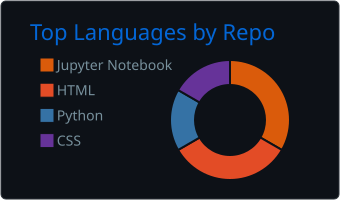
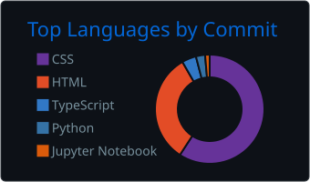

# MOHANRAJ S

### Data Engineer · Data Analyst · AI Systems Builder

**Building reliable data pipelines, engineering intelligence, and turning raw data into actionable insights.**

### Contribution Activity

### Repository Language Intelligence

Automated SVG snapshots are generated daily via GitHub Actions. Language distribution measures repository code and commit activity, not proficiency. Public profile views are a badge-service counter.

---

## ⚙ Core Technologies

| Domain | Tools & Capabilities |
|:---|:---|
| **Languages** | Python · SQL |
| **Data Engineering** | ETL/ELT · Data Pipelines · Apache Airflow · Spark/PySpark · Kafka · Databricks |
| **Databases** | MySQL · PostgreSQL |
| **Analytics & BI** | Power BI · Excel · Pandas · NumPy · Data Modeling |
| **AI & Automation** | LLM Integration · Local AI · Ollama · AI Agents · API Workflows |
| **Cloud & Dev Tools** | AWS · Azure · Google Cloud · Git · GitHub · Docker · VS Code |

Skills above are self-described professional capabilities. The language cards are calculated from GitHub repository data.

---

## ★ Notable Projects

<table>
<tr>
<td width="50%" valign="top">

### 🚇 [Hyderabad Metro Operations](https://github.com/mohanraj-official/HYDERABAD-METRO-OPERATIONS)

Operations analytics and data-driven performance insights.

`Data Analytics` `Operations` `Reporting`

[Explore repository](https://github.com/mohanraj-official/HYDERABAD-METRO-OPERATIONS)

</td>
<td width="50%" valign="top">

### 📸 [InstaScope](https://github.com/mohanraj-official/InstaScope)

Instagram / Meta API data ingestion and analytics pipeline for Power BI insights.

`Meta API` `Data Pipeline` `Power BI`

[Explore repository](https://github.com/mohanraj-official/InstaScope)

</td>
</tr>
<tr>
<td width="50%" valign="top">

### 🤖 JARVIS · Personal Local AI Assistant

Privacy-conscious local AI assistant exploring Ollama and agent-driven workflows.

`Local LLM` `Python` `Ollama`

**Private repository** · Public source not available

</td>
<td width="50%" valign="top">

### 📊 [Power BI Bank Loan Performance](https://github.com/mohanraj-official/PowerBI-Bank_loan_Performance_Analysis)

Business intelligence reporting and financial performance analysis.

`Power BI` `Analytics` `KPIs`

[Explore repository](https://github.com/mohanraj-official/PowerBI-Bank_loan_Performance_Analysis)

</td>
</tr>
</table>

### More Public Work

| Project | Focus |
|:---|:---|
| [E-Commerce Customer Churn](https://github.com/mohanraj-official/MySQL-E-Commerce_Customer_churn_Analysis) | MySQL & customer analytics |
| [Marketing Campaign Insights](https://github.com/mohanraj-official/Python---Marketing-Campaign-Performance-Insights) | Python & marketing analytics |
| [Credit Card Fraud Detection](https://github.com/mohanraj-official/Machine_Learning-Credit-Card-Fraud-Detection) | Machine learning |
| [Healthcare Analysis](https://github.com/mohanraj-official/Excel-Medical_Healthcare_Analysis) | Excel analytics |
| [Dashboards](https://github.com/mohanraj-official/DASHBOARDS) | Data visualization |

---

## ◈ What I Build

- **Reliable data systems:** extracting, cleaning, transforming and moving data efficiently.
- **Business intelligence:** dashboards that translate operational metrics into decisions.
- **AI-powered workflows:** local language models, API integrations and practical automation.
- **Scalable products:** connecting engineering choices to usability and measurable business outcomes.

### Data Engineering → Intelligence → Automation

GitHub profile analytics refresh daily around 06:00 IST after the scheduled workflow runs. External graph/badge updates depend on their providers and caching.

